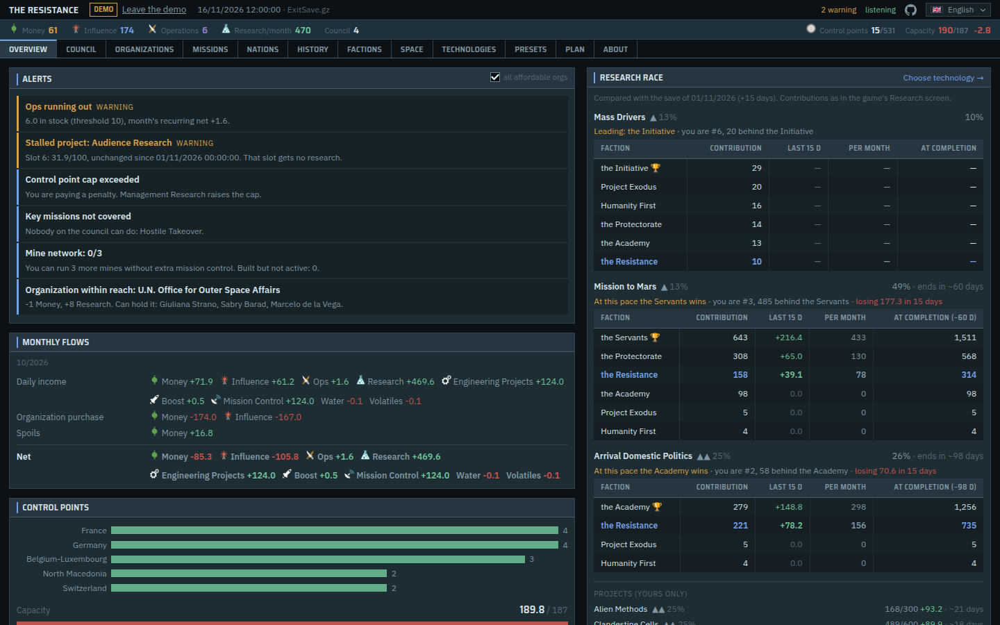
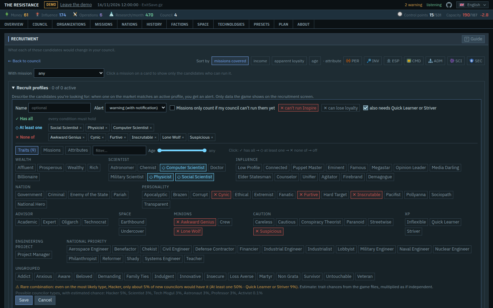
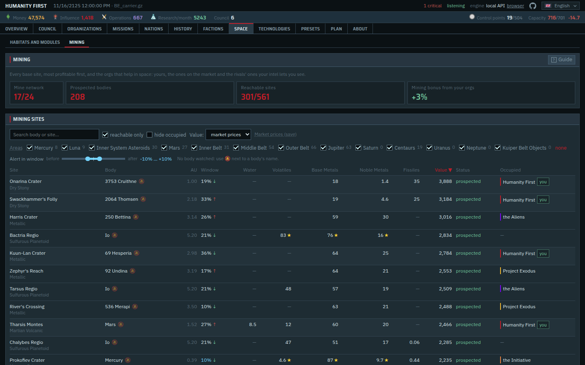
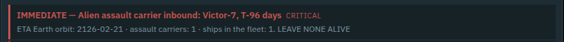
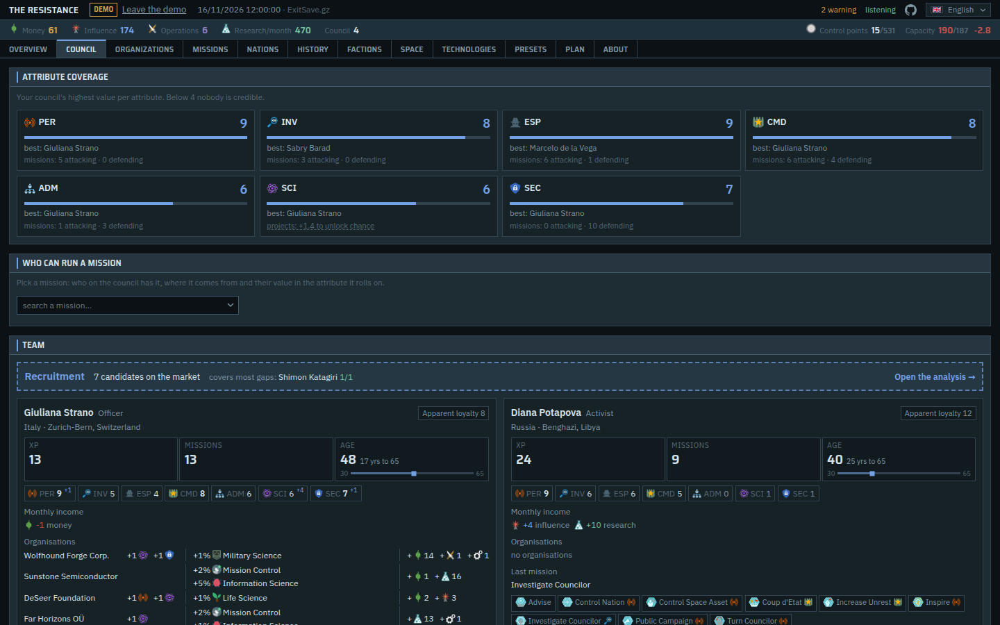
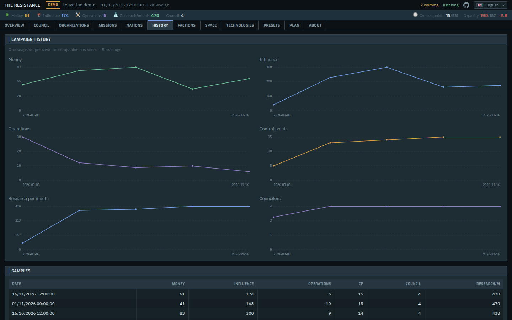

# TI Companion Plus

A second-screen companion for [Terra Invicta](https://store.steampowered.com/app/1176470/Terra_Invicta/).
It reads your save files and puts side by side what the game spreads across a dozen
screens: your council and who to recruit, which missions you can run and where, nations,
rival factions, mining sites and launch windows, technologies, and what changed since the
previous save.

**Open it at <https://ti-companion-plus.pages.dev>** in Chrome or Edge, pick your saves
folder, and keep it on your second monitor. Nothing to install. Your saves stay on your
PC. There's also a demo you can try in any browser.

A spinoff of [Terra Invicta Companion](https://github.com/b4p3p/terrainvicta-companion)
by b4p3p, with extra features. The original companion is their work; this project builds
on it separately.



It is a **reading aid, not a cheat**. The interface only shows information the game
already gives you: apparent loyalty, not real loyalty; no intel you haven't gathered; a
site's real mining yield only once you've probed its body. Where a number is this tool's
own heuristic rather than the game's formula, it says so and shows the raw values next
to it.

> Unofficial fan project. Not affiliated with, endorsed by, or connected to Pavonis
> Interactive or Hooded Horse.

## What's new in Plus

See [CHANGELOG.md](CHANGELOG.md) for everything, with where to find each feature.

- **Recruitment profiles** (Council → Recruitment). Describe the councilors you want
  (traits, missions, attributes, age) and get an alert when one shows up on the market.
  The companion warns you when the game's spawn rules make a combination impossible or
  rare.
- **Org profiles** (Organizations). Alerts only for the orgs you'd actually buy, instead
  of every org you can afford.
- **Launch windows and watched bodies** (Space → Mining). The Earth launch window for
  every mining body, computed as the game does, and an alert when a watched body's window
  opens and it has a free site. Optionally, only if your boost covers an Outpost Core.
- **Mining areas and unlocks** (Space → Mining). Filter sites by the game's own areas
  (Inner / Middle / Outer Belt, Centaurs, Kuiper Belt…), and see which "Mission to…"
  tech opens each unreachable site.
- **Mine network** (Space → Mining). The "mines used / mines allowed" number the game
  only shows in a tooltip.
- **Assault carrier warning** (Overview → Alerts). A critical alert counting down to a
  visible alien assault carrier's arrival, with escalating tags and your faction's motto.
- **DLC scenarios**. Broken Earth and 2003 games use their own data, so control points
  and names come out right.
- **Options to hide noise** on the Overview, e.g. only alien sites from the last year.

| Recruit profiles | Mining sites |
|---|---|
|  |  |



## Everything it shows

- **Overview**: alerts checked on every save, monthly flows, the research race against
  the other factions.
- **Council**: attribute coverage, missions nobody on the council can run, which recruit
  candidates would fill the gaps; recruitment profiles.
- **Organizations**: the org market with bonuses and incomes; org profiles.
- **Missions**: the real attacking and defending modifiers of each mission, taken from
  the game templates, with targets ranked on readable factors.
- **Nations**: control points, GDP, cohesion, unrest, trends over time; not-yet-born
  separatist states filtered out so they stop skewing every ranking. **YASS**:
  spreadsheet-style calculators for a nation's economy and priorities.
- **Factions**: rival factions and their councilors, compared only on what your intel
  unlocks, with the game's own thresholds.
- **Space**: visible habitats, Earth orbits and their free slots, buildable modules.
  **Mining**: every base site ranked by yield (real numbers on prospected bodies, the
  game's range elsewhere), launch windows, boost cost, and the orgs with space bonuses.
- **Technologies**: what each available tech unlocks for your faction, with the game's
  own project-unlock chance.
- **Presets**: custom national priority presets written as game files, without mods, so
  achievements stay enabled.
- **History, notes and goals**: every save archived per campaign, turn-to-turn diffs,
  export and import.
- **14 game languages**: mission, org and project names come from the game's official
  localization, never hand-translated. Interface in English and Italian.

| Council | History |
|---|---|
|  |  |

## Getting started

**On the website** (recommended): open <https://ti-companion-plus.pages.dev> in Chrome or
Edge, press **Choose folder** and pick `Documents\My Games\TerraInvicta`. Allow access
"on every visit" so it doesn't ask again. The page updates by itself every time the game
saves.

**Locally**, if you want to change the code or your browser can't open folders: see
[INSTALL.md](INSTALL.md). In short, with Python 3.10+, Node.js 20+ and Git:

```
git clone https://github.com/joesco726/ti-companion-plus.git
cd ti-companion-plus
pip install -e .
cd tiweb && npm install && cd ..
powershell -ExecutionPolicy Bypass -File start.ps1
```

### Troubleshooting

- **"This browser can't read a folder on your PC"**: use Chrome or Edge. In Brave, enable
  `brave://flags/#file-system-access-api` and restart. Firefox, Safari and phones can
  only run the demo.
- **Chrome refuses the folder**: pick `My Games` or `TerraInvicta`, not the whole
  `Documents` folder.
- **It asks for permission every time**: choose "Allow on every visit" in the prompt.
- **Local copy: "unable to connect" right after starting**: the first start compiles the
  interface; wait up to a minute and press F5.
- **Moving between the site and a local copy**: History → Companion data → Export on one
  side, Import on the other. Import merges, it never overwrites.

## CLI

`ti.py` is a thin layer over `ticore`, useful without a browser:

```bash
python ti.py status                 # default command
python ti.py council
python ti.py missions
python ti.py plan GainInfluence     # targets for a mission, ranked
python ti.py nations --all          # drop the Europe-only filter
python ti.py diff                   # what changed since the previous save
python ti.py alerts
python ti.py --list-saves
```

Useful flags: `--save <name or fragment>`, `--lang ita|en|fr|deu|…`, `--limit N`,
`--councilor <name>`, `--eu`.

## Architecture

```
ticore/     parser and domain logic. Python, zero dependencies, no UI.
tiserver/   FastAPI wrapper: /api/*, SSE on /api/stream, save-file watcher.
tiweb/      Next.js 16 + React 19 + Tailwind 4 + TypeScript.
ti.py       CLI on top of ticore.
```

`ticore` is deliberately dependency-free and UI-free: the same code serves the local API
and, compiled to WebAssembly through [Pyodide](https://pyodide.org/), the website. Its
routes live in `service.py` without any web framework; `tiserver` and the browser worker
(`tiweb/public/engine-worker.js`) both call `Service.dispatch()`.

| module | contents |
|---|---|
| `paths.py` | locates saves, templates, localization, data folder |
| `save.py` | loads the gzipped save and indexes gamestates; survives the file being locked while the game writes it |
| `gamedata.py` | JSON templates plus official localization in 14 languages; DLC scenario layers |
| `names.py` | translates names the save stores in the game's language back through their template keys |
| `council.py` | councilors (attributes with trait effects), orgs, coverage, missing missions |
| `profiles.py` | recruitment and org profiles: matching, spawn-rule checks, trait groups |
| `missions.py` | real mission factors and ranked targets |
| `model.py` | `snapshot()`: the full payload, control-point capacity |
| `alerts.py` | rule engine over consecutive snapshots |
| `factions.py` | rival factions and councilors, gated by intel like the game's own views |
| `fleets.py` | visible alien fleets heading for Earth (assault carrier alert) |
| `space.py` | habitats, Earth orbits, buildable modules and their cost |
| `mining.py` | mining sites (real yield or the game's estimate), areas, unlocks, mine network, orgs with space bonuses |
| `transfer.py` | launch windows and Outpost Core boost cost, with the game's orbital formulas |
| `watch.py` | watched mining bodies and the window band |
| `techs.py` | available techs and what they unlock for your faction |
| `yass.py` | starting data for the YASS nation calculators |
| `presets.py` | priority presets, written into the game's template files without mods |
| `service.py` | the `/api/*` routes, shared by the server and the browser |
| `store.py` | SQLite: history, notes, goals, profiles and settings, per campaign |
| `portable.py` | export and merge-import of the companion's data |
| `bundle.py` | the game-data extract used by the website |
| `texts.py` | the core's own texts (alerts, errors) in English and Italian |

### API

`/api/health` · `/api/version` · `/api/snapshot?lang=` · `/api/alerts` · `/api/options` ·
`/api/missions` · `/api/missions/{name}/plan` · `/api/nations/trends` ·
`/api/nations/{name}/detail` · `/api/yass` · `/api/factions` (+ `councilors`) ·
`/api/space` · `/api/mining` (+ `watch`) · `/api/techs` · `/api/research` ·
`/api/profiles` (+ `thresholds`) · `/api/orgprofiles` · `/api/presets` (+ `export`,
`install`, `restore`, `custom`) · `/api/history` · `/api/campaigns` · `/api/diff` ·
`/api/notes` · `/api/goals` · `/api/data` (+ `export`, `import`) · `/api/saves` ·
`/api/languages` · `/api/stream` (SSE)

## Where the game data comes from

- **Saves**: `%USERPROFILE%\Documents\My Games\TerraInvicta\Saves\*.gz` (OneDrive-redirected
  Documents included). If neither exists, the path is read from `savedGamesPath` in the
  game's `Player.log`.
- **Templates and localization**: the local version reads them from your installation,
  `<Steam>\steamapps\common\Terra Invicta\TerraInvicta_Data\StreamingAssets\`, in any
  Steam library (or the folder in `TI_GAME_DIR`, if set). The browser can't reach that
  folder, so the website serves a minimal extract generated by `python -m ticore.bundle`.
  The extract is Pavonis Interactive's data and is not stored in this repository.
- **Icons**: `assets/icons/` holds the mission, resource, faction and cursor icons. In
  the game they live inside Unity asset bundles, not as files; if a mission, resource or
  faction icon is missing, the local server re-extracts it from your own copy of the game
  (`pip install -e ".[icons]"` pulls in UnityPy for that).

## Feedback

Any request, bug report or suggestion is welcome: something the game shows that you'd
like side by side, a number that doesn't match what you see in game, a screen that's
confusing. [Open an issue](https://github.com/joesco726/ti-companion-plus/issues) and
I'll take a look.

## License

Source code: MIT; see [LICENSE](LICENSE).

The images under `assets/icons/` are **not** covered by it. They are Terra Invicta
artwork, © Pavonis Interactive, included unmodified for identification in a
non-commercial fan tool. See [assets/icons/README.md](assets/icons/README.md).
